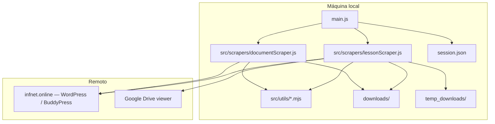
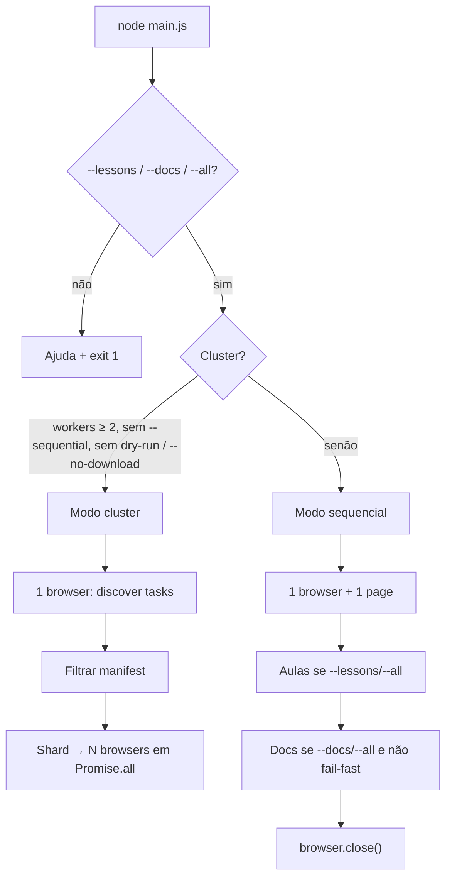
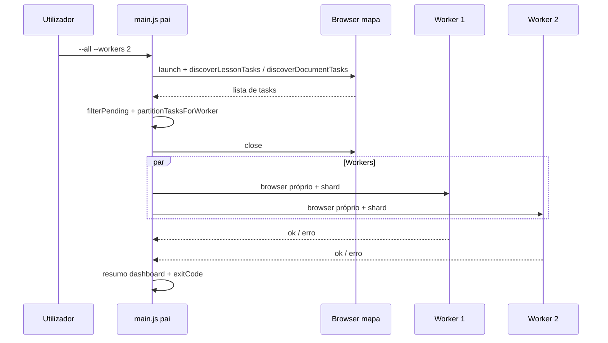
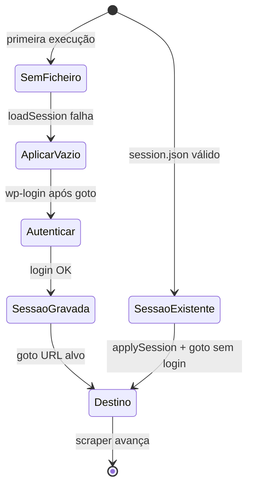

# StripperScrapper — Arquitetura, funcionamento e fluxos

> Documento de análise da estrutura e dos fluxos do projeto, com base no código (`main.js`, scrapers e `src/utils/`) e na documentação existente (`README.md`, `documentation.md`).

**Nota:** StripperScrapper **não é um bot de chat**. É uma ferramenta CLI local (Node.js + Puppeteer) que automatiza a extração de conteúdos do portal Infnet para o disco.

---

## Table of Contents

- [O que é](#o-que-é)
- [Propósito e âmbito](#propósito-e-âmbito)
- [O que faz (e o que não faz)](#o-que-faz-e-o-que-não-faz)
- [Stack](#stack)
- [Estrutura de pastas](#estrutura-de-pastas)
- [Visão do sistema](#visão-do-sistema)
- [Como o orquestrador funciona](#como-o-orquestrador-funciona)
- [Modo sequencial](#modo-sequencial)
- [Modo cluster / multi-worker](#modo-cluster--multi-worker)
- [Fluxo 1 — Autenticação (comum)](#fluxo-1--autenticação-comum)
- [Fluxo 2 — Aulas / transcrições](#fluxo-2--aulas--transcrições)
- [Fluxo 3 — Documentos BuddyPress](#fluxo-3--documentos-buddypress)
- [Manifest, idempotência e resiliência](#manifest-idempotência-e-resiliência)
- [Saídas no disco](#saídas-no-disco)
- [Comandos e flags](#comandos-e-flags)
- [Variáveis de ambiente](#variáveis-de-ambiente)
- [Dashboard TUI](#dashboard-tui)
- [API programática (`toMarkdown`)](#api-programática-tomarkdown)
- [Limites e manutenção](#limites-e-manutenção)
- [Relação com outros documentos](#relação-com-outros-documentos)

---

## O que é

Automatiza, com a sessão do utilizador autenticado em `infnet.online` (WordPress / BuddyPress):

1. **Aulas / transcrições** — lista gravações na página de reuniões, abre a transcrição no **Google Drive**, descarrega via CDP e materializa ficheiro + `.md` com front-matter.
2. **Documentos BuddyPress** — percorre recursivamente `/documents/`, extrai links no DOM e baixa ficheiros com **cookies da sessão** via `fetch` no Node.

Não existe servidor HTTP, fila de jobs nem API exposta: tudo corre na máquina do utilizador.

---

## Propósito e âmbito

| Aspeto | Descrição |
|--------|-----------|
| **Problema** | Conteúdos ficam atrás de login e de UI web (Drive, listagens BuddyPress), sem endpoint público estável. |
| **Solução** | Replicar o fluxo humano com browser controlado; transcrições com CDP + rename + `.md`; documentos com `fetch` autenticado. |
| **Quem usa** | Quem tem **acesso legítimo** ao conteúdo e pretende **cópia local** organizada. |

O nome do repositório é um jogo de palavras com “strip” (extração) e “scraper”; o âmbito é **extração autorizada** para uso pessoal/académico.

**Dependência de UI:** seletores em `infnet.online`, Drive e BuddyPress podem mudar; ver `documentation.md` e, se existir, `VALIDACAO_SELETORES.md`.

---

## O que faz (e o que não faz)

**Faz**

- Arranca Chrome (ou caminho em env), opcionalmente visível (`--headed` / `HEADLESS=0`).
- Reutiliza ou cria `session.json` (cookies + `localStorage`).
- **Aulas:** lista itens de gravação, abre transcrição no Drive, descarrega, move de `temp_downloads/` e gera `.md` com front-matter.
- **Documentos:** percurso em `/documents/`, download com cookies da sessão, extensões configuráveis (por defeito `pdf`, `pptx`, `xlsx`).
- **Orquestrador:** `--all`, `--lessons`, `--docs`, `--fail-fast`; `browser.close()` no `finally`.
- **Cluster:** mapeamento → filtragem por manifest → sharding → N workers com browser próprio.
- **Resiliência:** até 3 retries por item, validação de integridade, DLQ no manifest.

**Não faz**

- Não fornece credenciais nem contorna MFA fora do que o browser já tiver em sessão.
- Não garante compatibilidade eterna com alterações de HTML nos sites.
- Não substitui políticas da instituição ou termos de serviço — o utilizador é responsável pelo uso conforme contratos e leis aplicáveis.

---

## Stack

| Componente | Detalhe |
|------------|---------|
| Runtime | Node.js com **ESM** (`"type": "module"`) |
| Automação | `puppeteer` (Chrome/Chromium) |
| CLI | `commander` em `main.js` |
| Config | `dotenv` |
| UI terminal | `blessed` / `blessed-contrib` (dashboard TUI) |
| Logging | `chalk` |

---

## Estrutura de pastas

| Path | Papel |
|------|--------|
| `main.js` | Orquestrador CLI: escolhe módulos, modo sequencial ou cluster, dashboard |
| `src/scrapers/lessonScraper.js` | Aulas / Drive + manifest `transcript`; exports incl. `toMarkdown`, `discoverLessonTasks`, `runLessonScraper` |
| `src/scrapers/documentScraper.js` | Documentos BuddyPress + manifest `document`; `discoverDocumentTasks`, `runDocumentScraper` |
| `src/utils/infnetShared.mjs` | Sessão, login, Chrome, caminhos seguros, `ensureAuthenticated` |
| `src/utils/downloadManifest.mjs` | `manifest.json`, IDs estáveis, conclusão, locks, DLQ |
| `src/utils/browser.mjs` | `launchBrowser`, resolução do executável |
| `src/utils/shard.mjs` | Partição determinística de tarefas entre workers |
| `src/utils/workerLog.mjs` | Logs por worker (`chalk`) |
| `src/utils/retry.mjs` | Retries com backoff + jitter |
| `src/utils/integrity.mjs` | Validação de ficheiros antes de marcar concluído |
| `src/utils/dashboard.mjs` | Dashboard TUI (progresso, workers, ETA) |
| `src/utils/logging.mjs` | Banners de secção no orquestrador |
| `.env` / `.env.example` | Credenciais e URLs |
| `session.json` | Cookies + localStorage (gerado em runtime; **não commitar**) |
| `downloads/` | Saídas e `manifest.json` |
| `temp_downloads/` | Buffer de download do Chrome |

---

## Visão do sistema



---

## Como o orquestrador funciona

O ponto de entrada é `main.js`. É **obrigatório** passar `--lessons`, `--docs` ou `--all`; caso contrário mostra a ajuda do Commander e termina com código **1**.



### Decisão cluster vs sequencial

| Condição | Modo |
|----------|------|
| `--sequential` | Sequencial |
| `--workers 1` | Sequencial (efeito equivalente) |
| `--no-download` (aulas) ou `--dry-run` (docs) | Sequencial |
| `--workers N` com N ≥ 2 e sem as condições acima | **Cluster** |

`ORCHESTRATOR_FAIL_FAST` (`1` / `true` / `yes`) equivale a `--fail-fast`.

---

## Modo sequencial

Fluxo clássico com **um browser** e **uma page** partilhada:

1. `launchBrowser` → `newPage`
2. Se aulas ativas → `runLessonScraper({ browser, page })`
3. Se documentos ativos e não abortados por fail-fast → `runDocumentScraper({ browser, page })`
4. `browser.close()` no `finally`

Com `--fail-fast`: se o módulo de aulas lançar exceção, o orquestrador **não** corre documentos.

Cada scraper **não** fecha o browser quando chamado pelo orquestrador — a responsabilidade é do `main.js` (ou dos `*Standalone`).

---

## Modo cluster / multi-worker

Ativa quando `--workers <n>` com **n > 1** e **sem** `--sequential` (e sem dry-run / no-download).

### Fases

1. **Mapeamento (crawl)** — o processo pai abre **um** browser e descobre tarefas:
   - Aulas: `discoverLessonTasks`
   - Documentos: `discoverDocumentTasks`
2. **Filtragem** — remove itens já concluídos no manifest (`verifyArtifact`)
3. **Sharding** — `partitionTasksForWorker` (partição determinística)
4. **Download** — `Promise.all` com N workers; cada um:
   - abre o seu próprio browser
   - executa o shard de aulas e/ou documentos (sem refazer crawl)
   - usa `temp_downloads/worker-<id>` nas aulas (evita colisões)
   - fecha o browser no `finally`

### Notas de cluster

- Workers tendem a **headless** (poupar RAM); `--headed` / `--show` mantém visibilidade.
- Logs com prefixos `[WORKER-n][AULAS]` / `[WORKER-n][DOCS]`.
- Fail-fast por worker: se aulas falharem nesse worker e `--fail-fast` estiver ativo, esse worker salta o seu shard de documentos.
- Limites práticos: RAM, CPU e rede escalam com N browsers; começar com **2–4 workers**.



---

## Fluxo 1 — Autenticação (comum)

Implementado em `src/utils/infnetShared.mjs` via `ensureAuthenticated`.



Passos:

1. `loadSession(session.json)` — se existir, aplica cookies + `localStorage`
2. `gotoUrl` para a URL alvo (`CLASSES_URL` ou `DOCUMENTS_URL`)
3. Se a URL atual incluir `wp-login.php`:
   - exige `FACULDADE_USER` / `FACULDADE_PASS`
   - `login` → novo `goto` → se ainda em login, erro
   - `saveSession` (escrita atómica + lock `session.json.write.lock`)
4. Se sessão válida: log `[LOGIN] Sessão válida` (e grava sessão se ainda não havia ficheiro)

A **mesma** `session.json` na raiz do repo serve aulas e documentos no mesmo browser (modo sequencial) ou é reutilizada/atualizada pelos workers (com lock de escrita).

---

## Fluxo 2 — Aulas / transcrições

Módulo: `src/scrapers/lessonScraper.js`.

### Entradas

- `CLASSES_URL` (ou default no código)
- Credenciais / sessão
- Flags: `--limit=N`, `--no-download`, `--headed` / `--show`
- Em cluster: `opts.tasks` (já descobertas) + `tempDownloadsDir` por worker

### Etapas por execução

1. Garante pastas `downloads/` e `temp_downloads/` (ou `temp_downloads/worker-<id>`)
2. `ensureAuthenticated` em `CLASSES_URL`
3. **Discover** (se não houver `opts.tasks`):
   - `page.evaluate` em `.infnetci-recording-item` + links de transcrição
   - resolve nome do curso (`DISCIPLINE_NAME` / `COURSE_NAME` → página → URL → fallback)
4. Para cada item (até `--limit`):
   - Se já `isItemCompleted` no manifest → skip
   - Se `--no-download` → só log (dry-run)
   - Senão, com até **3 retries**:
     1. Abre Drive (`openTranscriptPageByIndex` — popup ou mesma page)
     2. CDP `Page.setDownloadBehavior` → pasta temp
     3. `clickDriveDownload` (frames + seletores PT/EN)
     4. `waitNewStableFile` (ignora `.crdownload` / `.tmp`)
     5. `rename` para `downloads/<Secção>/<slug>.<ext>`
     6. `validateBinaryFile`
     7. `toMarkdown` com front-matter
     8. `markArtifactCompletedIfPresent`
   - Em falha final: limpa artefactos parciais + `markArtifactError` (DLQ)
   - Fecha popup (se houver) e volta à lista de aulas

### Front-matter do `.md`

Campos principais: `title`, `source_url`, `course`, `transcript_file`, `downloaded_at`.

### Exports relevantes

| Função | Uso |
|--------|-----|
| `parseLessonArgs` | Flags de aulas |
| `discoverLessonTasks` | Fase mapa (cluster) |
| `runLessonScraper` | Execução (orquestrador / worker) |
| `runLessonScraperStandalone` | Browser próprio (depuração) |
| `toMarkdown` | Conversão de ficheiro já descarregado (sem Puppeteer) |

---

## Fluxo 3 — Documentos BuddyPress

Módulo: `src/scrapers/documentScraper.js`.

### Entradas

- `DOCUMENTS_URL` ou `--documents-url=` (pode ser **inferida** a partir de `CLASSES_URL` no formato `/grupos/{slug}/…` → `/grupos/{slug}/documents/`)
- `DOCUMENTS_OUTPUT_DIR` / `--output=` (default `downloads/documents`)
- Extensões, profundidade, limites de bytes/timeout
- Flags: `--dry-run`, `--ignore-manifest`, `--max-depth=`, `--extensions=`

### Etapas

1. `ensureAuthenticated` em `DOCUMENTS_URL`
2. **BFS** de pastas (`collectDocumentTasksFromSite` / loop inline no modo sequencial):
   - `loadListing` com scroll suave para conteúdo lazy
   - extrai pastas + ficheiros do DOM
   - respeita `maxDepth` (default 32)
3. Filtra por extensão (default: `pdf`, `pptx`, `xlsx`; `--extensions=` ou `DOCUMENTS_EXTENSIONS` substitui o conjunto)
4. Por ficheiro:
   - skip se concluído no manifest (salvo `--ignore-manifest` / dry-run)
   - download via `downloadBinaryWithSession` (`fetch` + header `Cookie` da page)
   - limites: `DOCUMENTS_MAX_BYTES` (default 500 MiB), `DOCUMENTS_FETCH_TIMEOUT_MS` (default 300000)
   - `validateBinaryFile` (não vazio, sniff anti-HTML, `content-length` quando existe)
   - `markArtifactCompletedIfPresent` ou DLQ após retries

### Modos de execução do scraper

| Contexto | Comportamento |
|----------|---------------|
| Sequencial / standalone **sem** `opts.tasks` | BFS + download inline |
| Cluster **com** `opts.tasks` | Só baixa o shard; não refaz crawl |

### Exports relevantes

| Função | Uso |
|--------|-----|
| `parseDocumentArgs` | Flags de documentos |
| `discoverDocumentTasks` | Fase mapa (cluster) |
| `runDocumentScraper` | Execução |
| `runDocumentScraperStandalone` | Browser próprio |

---

## Manifest, idempotência e resiliência

### Manifest

Ficheiro típico: `downloads/manifest.json`.

- IDs estáveis: `transcript:…` (ex. Google Drive file id) e `document:…` (BuddyPress / hash de URL)
- Antes de baixar: `isItemCompleted(..., { verifyArtifact: true })` — se o ficheiro foi apagado do disco, o item volta a ficar pendente
- Escrita concorrente protegida por lock (`manifest.json.queue.lock`) + escrita atómica

### Retries e integridade

- Até **3 tentativas** por item (`withRetries`) com backoff + jitter
- Validação antes de marcar concluído:
  - ficheiro existe e `size > 0`
  - sniff simples para evitar gravar HTML (sessão expirada / redirect de login)
  - em documentos, valida tamanho esperado quando há `content-length`
- Falha após retries → entrada DLQ com `status: "error"`, `reason`, `attempts`, `errorKind`, `lastError`

---

## Saídas no disco

| Caminho | Conteúdo |
|---------|----------|
| `downloads/<Secção>/` | Transcrições + `.md` por item |
| `downloads/documents/` | Árvore de documentos (default) |
| `downloads/manifest.json` | Estado por ID estável |
| `temp_downloads/` | Buffer de download do Chrome |
| `temp_downloads/worker-<id>/` | Buffer por worker (cluster) |
| `session.json` | Cookies + `localStorage` — **não commitar** |

---

## Comandos e flags

### Scripts npm

| Comando | Equivalente |
|---------|-------------|
| `npm start` / `npm run main` | `node main.js` |
| `npm run all` | `node main.js --all` |
| `npm run lessons` / `npm run stripper` | `node main.js --lessons` |
| `npm run docs` / `npm run documents` | `node main.js --docs` |

### Flags do orquestrador (`main.js`)

| Opção | Efeito |
|-------|--------|
| `--all` | Aulas e documentos |
| `--lessons` | Só aulas |
| `--docs` | Só documentos |
| `--workers <n>` | Cluster com N browsers (default do Commander: 2) |
| `--sequential` | Um browser, execução em série |
| `--fail-fast` | Após erro fatal em aulas, não corre documentos |
| `--no-dashboard` | Desativa TUI |

### Flags comuns dos scrapers (permanecem em `argv`)

Exemplos: `--limit=N`, `--headed` / `--show`, `--documents-url=`, `--output=`, `--dry-run`, `--no-download`, `--ignore-manifest`, `--max-depth=`, `--extensions=`.

### Exemplos

```bash
# Setup
cp .env.example .env
npm install

# Só aulas
npm start -- --lessons

# Aulas + docs, sequencial
npm start -- --all --sequential

# Cluster com 4 workers
node main.js --all --workers 4

# Browser visível
npm start -- --lessons --headed

# Limitar a 2 aulas
npm run lessons -- --limit=2
```

---

## Variáveis de ambiente

### Aulas / geral

| Variável | Obrigatório | Descrição |
|----------|-------------|-----------|
| `FACULDADE_USER` | Se for preciso login após sessão | E-mail WordPress Infnet |
| `FACULDADE_PASS` | Idem | Senha |
| `CLASSES_URL` | Não | URL da página de reuniões |
| `DISCIPLINE_NAME` ou `COURSE_NAME` | Não | Nome da disciplina nos metadados |
| `PUPPETEER_EXECUTABLE_PATH` | Condicional | Chrome do sistema |
| `HEADLESS` | Não | `0` força browser visível (com headed) |
| `ORCHESTRATOR_FAIL_FAST` | Não | Igual a `--fail-fast` |

### Documentos

| Variável | Descrição |
|----------|-----------|
| `DOCUMENTS_URL` | URL raiz da área de documentos |
| `DOCUMENTS_OUTPUT_DIR` | Saída (default `downloads/documents`) |
| `DOCUMENTS_MAX_DEPTH` | Profundidade máxima de pastas (default 32) |
| `DOCUMENTS_EXTENSIONS` | Substitui extensões aceites (ex.: `mp4,mov`) |
| `DOCUMENTS_MAX_BYTES` | Limite por ficheiro (default 500 MiB) |
| `DOCUMENTS_FETCH_TIMEOUT_MS` | Timeout do `fetch` (default 300000) |
| `DOCUMENTS_IGNORE_MANIFEST` | `1` / `true` / `yes` — ignora manifest |

---

## Dashboard TUI

- Ativo por defeito quando há TTY e **não** se passa `--no-dashboard`
- Implementação: `src/utils/dashboard.mjs` (blessed / blessed-contrib)
- Agrega: progresso global, status por worker, throughput/ETA, erros
- Em CI ou piping: usar `--no-dashboard` para logs lineares

---

## API programática (`toMarkdown`)

Não depende do Puppeteer — útil para converter um ficheiro já descarregado (ex. `.vtt`):

```javascript
import { toMarkdown } from './src/scrapers/lessonScraper.js';

await toMarkdown('/caminho/para/ficheiro.vtt', {
  title: 'Aula 1',
  source_url: 'https://…',
  course: 'Nome da disciplina',
  downloaded_at: new Date().toISOString(), // opcional
});
```

---

## Limites e manutenção

- **Seletores frágeis:** alterações no Infnet, Drive ou BuddyPress podem partir o scrape.
- **MFA / captcha:** não tratados automaticamente; usar `--headed` e sessão manual se necessário.
- **Cluster:** cada worker = um Chrome; memória e rede são o teto prático.
- **Conformidade:** o utilizador é responsável pelo uso conforme termos da instituição e leis aplicáveis.
- Credenciais só em `.env` local; não commitar `.env` nem `session.json`.

### Troubleshooting rápido

| Sintoma | Direção |
|---------|---------|
| Chrome não encontrado | Instalar Chrome ou definir `PUPPETEER_EXECUTABLE_PATH` |
| Lista vazia de aulas | Sessão/URL/seletores; correr com `--headed` |
| Timeout no Drive | UI/iframe/idioma; pode precisar de novos seletores |
| Login falha | MFA/captcha; apagar `session.json` e tentar headed |
| Documento HTML em vez de PDF | Sessão expirada ou sem permissão |

---

## Relação com outros documentos

| Artefacto | Papel |
|-----------|--------|
| **Este ficheiro** (`ARQUITETURA_E_FLUXOS.md`) | Resumo consolidado de estrutura, funcionamento e todos os fluxos |
| [`README.md`](./README.md) | Onboarding e operação rápida |
| [`documentation.md`](./documentation.md) | Referência técnica mais longa |
| [`VALIDACAO_SELETORES.md`](./VALIDACAO_SELETORES.md) | Notas sobre seletores (se existir) |
| [`.env.example`](./.env.example) | Modelo de configuração |
