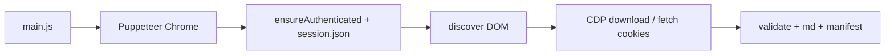
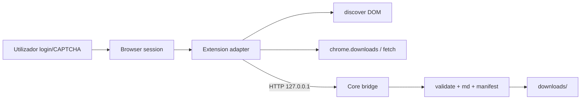

# Architecture — StripperScrapper (pós-migração Browser Extension)

| Campo | Valor |
|-------|-------|
| Sistema | StripperScrapper |
| Última actualização | 2026-08-09 |
| Status | draft (aguarda aprovação Fase 0.5) |

## Visão geral

Migrar a **camada de acesso ao site** de Puppeteer para Browser Extension; preservar o **Scraper Core** Node para manifest, validação, retries, Markdown e organização de saída.

```
Navegador (sessão humana + CAPTCHA)
   ├── Site Infnet / Drive / BuddyPress
   └── Browser Extension (adapter)
            │  HTTP 127.0.0.1 + token local
            ↓
       Scraper Core (Node)
            ├── Discovery ingest / Download manager
            ├── integrity + retry
            ├── toMarkdown + paths
            ├── downloadManifest (manifest.json / DLQ)
            └── downloads/
```

## Camadas

| Camada | Responsabilidade | Tecnologia | Path previsto |
|--------|------------------|------------|---------------|
| 1. Browser Adapter | Auth state, discovery DOM, navegação, iniciar downloads, UI, progresso | MV3 extension (Chrome) | `extension/` |
| 2. Transport Bridge | Contrato HTTP local; auth token loopback | Node `http` | `src/bridge/` ou `src/core/server.mjs` |
| 3. Scraper Core | Orquestração de processamento pós-artefacto | Node ESM | scrapers refactor + `main` bridge |
| 4. Download/Artifact Manager | Estabilidade ficheiro, move, temp dirs | Node + `chrome.downloads` | core + extensão |
| 5. Manifest | IDs estáveis, skip/pending/retry/DLQ, lock, atomic write | `downloadManifest.mjs` | **mantido** |
| 6. Processing/Normalization | `validateBinaryFile`, `toMarkdown`, front-matter | `integrity.mjs`, `lessonScraper.toMarkdown` | **mantido** |
| 7. Output | `downloads/<Secção>/`, `downloads/documents/` | FS | **inalterado** |

## Fluxo antigo vs novo

### Antigo (Puppeteer)



### Novo (Extension + Core)



## Fluxos principais

### Fluxo 1 — Autenticação

1. Utilizador abre Infnet e autentica (CAPTCHA manual).
2. Extensão inspeciona página (URL ≠ `wp-login.php`, indicadores de sessão).
3. Estado → `AUTHENTICATED` (ou `SESSION_EXPIRED` se redirecionar a login).
4. **Não** grava cookies no core; **não** usa `session.json` neste path (ADR-0002).

### Fluxo 2 — Discovery aulas

1. Extensão navega a `CLASSES_URL` (configurável).
2. Extrai `.infnetci-recording-item` + `.transcription-link` (mesma lógica que `extractLessonItemsFromPage`).
3. Calcula `transcriptItemId` via mesma regra que `stableTranscriptItemId` (implementação partilhada ou espelho contractualmente idêntico).
4. Envia lista ao core / mostra na UI; modo discover-only pára aqui.

### Fluxo 3 — Download aula

1. Core/UI confirma task pending no manifest (`verifyArtifact`).
2. Extensão abre Drive, dispara download.
3. Aguarda ficheiro estável (API downloads; sem CDP).
4. Notifica core com path/metadados.
5. Core: validate → move → `toMarkdown` → `markArtifactCompletedIfPresent` / DLQ.

### Fluxo 4 — Documentos BuddyPress

1. Extensão BFS (lazy scroll, maxDepth, extensions) — lógica espelhada de `collectDocumentTasksFromSite`.
2. Download autenticado no contexto do browser.
3. Core valida + manifest (igual ao path actual).

### Fluxo 5 — Idempotência / retries

Comportamento **inalterado** em `downloadManifest.mjs` + `withRetries` (3 tentativas, backoff `[400,1200,2500]` + jitter 25%).

`SESSION_EXPIRED` / CAPTCHA pendente: **não** retry automático infinito — pausa e pede reauth na UI.

## Mapeamento scraper antigo → extensão/core

| Componente actual | Destino |
|-------------------|---------|
| `ensureAuthenticated` / `login` / `session.json` | Extensão (auth state); legado CLI opcional |
| `discoverLessonTasks` / DOM extract | Extensão (content script) + IDs partilhados |
| `openTranscriptPage` + CDP `setDownloadBehavior` | Extensão (`chrome.downloads`) |
| `waitNewStableFile` | Core e/ou extensão adaptado a downloads API |
| `toMarkdown` | Core **mantido** |
| `discoverDocumentTasks` / BFS | Extensão |
| `downloadBinaryWithSession` (fetch+Cookie) | Extensão (credenciais do browser) |
| `validateBinaryFile` | Core **mantido** |
| `downloadManifest.*` | Core **mantido** |
| `withRetries` | Core **mantido** (e política espelhada na fila da extensão) |
| `main.js` cluster/shard | CLI legado; extensão = fila sequencial (ADR-0003) |
| `dashboard.mjs` TUI | UI popup da extensão (operacional) |

## Integrações externas

| Sistema | Protocolo | Propósito |
|---------|-----------|-----------|
| infnet.online | HTTPS (browser) | Aulas, docs, auth |
| Google Drive | HTTPS (browser) | Transcrições |
| Core bridge | HTTP loopback | Metadados + ingest |

## Decisões arquitecturais

| ADR | Decisão |
|-----|---------|
| 0001 | Bridge HTTP `127.0.0.1` |
| 0002 | `session.json` não primário no path extensão |
| 0003 | Sem cluster multi-browser na extensão |

## Limitações conhecidas (v1)

- Sem paralelismo multi-browser.
- Core deve estar a correr para processar.
- Dependência de seletores UI.
- Drive UI pode exigir adaptação sem CDP.
- Testes E2E reais exigem sessão humana (CAPTCHA).
