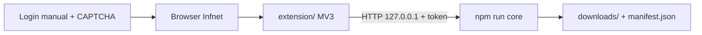

# Operação — Browser Extension + Core Bridge

Path recomendado quando o Infnet exige CAPTCHA no login. O CLI Puppeteer (`npm start`) permanece como legado opcional.

## Arquitectura (resumo)



| Camada | Responsabilidade |
|--------|------------------|
| Extensão | Sessão humana, discovery DOM, downloads (`chrome.downloads`) |
| Core bridge | Validação, Markdown, manifest, DLQ, contagens |
| `session.json` | **Não** usado neste path (ADR-0002) |

## Arranque

### 1. Core

```bash
npm install
npm run core
```

- Escuta `http://127.0.0.1:8787`
- Token em `.bridge-token` (não aparece nos logs — `cat .bridge-token`)
- Inbox default: `~/Downloads` (`STRIPPER_INBOX_DIR` para override)
- Saída final (core): `downloads/<Secção>/` (aulas) + `downloads/documents/…` + `manifest.json`
- Inbox Chrome (`~/Downloads/StripperScrapper/`): mesma árvore — aulas por secção na raiz; PDFs/PPTX sob `documents/`

### 2. Extensão

1. Chrome → `chrome://extensions` → Developer mode → **Load unpacked**
2. Seleccionar pasta `extension/` deste repositório
3. Abrir popup: Bridge URL `http://127.0.0.1:8787` + colar token → Health check
4. Preencher `CLASSES_URL` / `DOCUMENTS_URL` do grupo do semestre

### 3. Autenticação

1. Abrir `infnet.online` e fazer login **manualmente**
2. Resolver CAPTCHA se aparecer
3. Popup → **Verify auth** → estado `AUTHENTICATED`
4. Sem armazenamento de password Infnet na extensão

## Discovery e download

| Acção | Modo |
|-------|------|
| Só listar tarefas | `discover_only` |
| Listar + baixar | `discover_and_download` |
| Âmbito | Aulas / Documentos / Tudo |
| Manifest | Continuar (default) ou Ignorar |
| Fail-fast | opcional |

Fluxo típico: **Discover** → rever contagens (pending/completed) → **Start download** → progresso no popup.

**Importante:** o botão **Start download** força sempre `discover_and_download`. Use **Discover** se quiser só listar sem baixar. Se nos logs aparecer `mode: "discover_only"` no `START_DOWNLOAD`, nada será baixado — recarregue a extensão ≥0.1.3.

IDs estáveis: `transcript:…` / `document:…` (iguais ao scraper legado — reexecutar faz SKIP).

## Refresh de semestre

1. Actualizar `CLASSES_URL` / `DOCUMENTS_URL` para o grupo novo
2. Discovery — novos itens ficam pending; materiais antigos no `downloads/` mantêm-se
3. Não misturar semestres no mesmo `course` sem critério — usar pastas/secções existentes

## Sessão expirada

- Extensão → `SESSION_EXPIRED` ou core devolve `errorKind: session_expired` (HTML de login)
- Run passa a `paused_auth` — **não** retry infinito
- Relogar no site → Verify auth → retomar download

## Checklist E2E manual

- [ ] Extensão carregada unpacked
- [ ] Core a correr; health 200; token colado
- [ ] Não autenticado → estado detectado
- [ ] Login + CAPTCHA manual → `AUTHENTICATED`
- [ ] Discovery aulas > 0 (URL correcta)
- [ ] Discovery documentos (BFS) com pdf/pptx/xlsx
- [ ] Download 1 aula → ficheiro em `downloads/<Secção>/` + `.md` com front-matter
- [ ] Download 1 PDF e 1 PPTX → `downloads/documents/…`
- [ ] 2ª execução → completed skipped; falhas em retry
- [ ] Apagar um artefacto → volta pending
- [ ] Após 3 falhas → entrada DLQ (`status: error`) no manifest
- [ ] Cancelar run a meio
- [ ] Reiniciar extensão / reiniciar core e retomar
- [ ] Logs sem cookies/senhas/token bridge

## Variáveis úteis

| Env | Default | Uso |
|-----|---------|-----|
| `STRIPPER_BRIDGE_PORT` | `8787` | Porta loopback |
| `STRIPPER_INBOX_DIR` | `~/Downloads` | Onde a extensão deixa ficheiros |
| `STRIPPER_DOWNLOADS_DIR` | `<repo>/downloads` | Saída final (ex.: `…/ISS/downloads`) |

## Limitações conhecidas

- Chrome pode não expor path absoluto → core resolve via inbox + `filename`
- Sem cluster multi-browser na extensão (ADR-0003)
- Seletores Infnet/Drive frágeis (igual ao legado)
- Service worker MV3 pode suspender em filas muito longas
- E2E CAPTCHA não é automatizável nos testes CI

## Referências

- Arquitectura: [`ARCHITECTURE.md`](./ARCHITECTURE.md)
- API bridge: [`API_SPEC.md`](./API_SPEC.md) · [`contracts/bridge-v1.yaml`](./contracts/bridge-v1.yaml)
- ADRs: `0001` bridge HTTP · `0002` session.json · `0003` sem cluster
- Spike downloads: `memory/browser-extension-migration/spike-drive-downloads.md`
